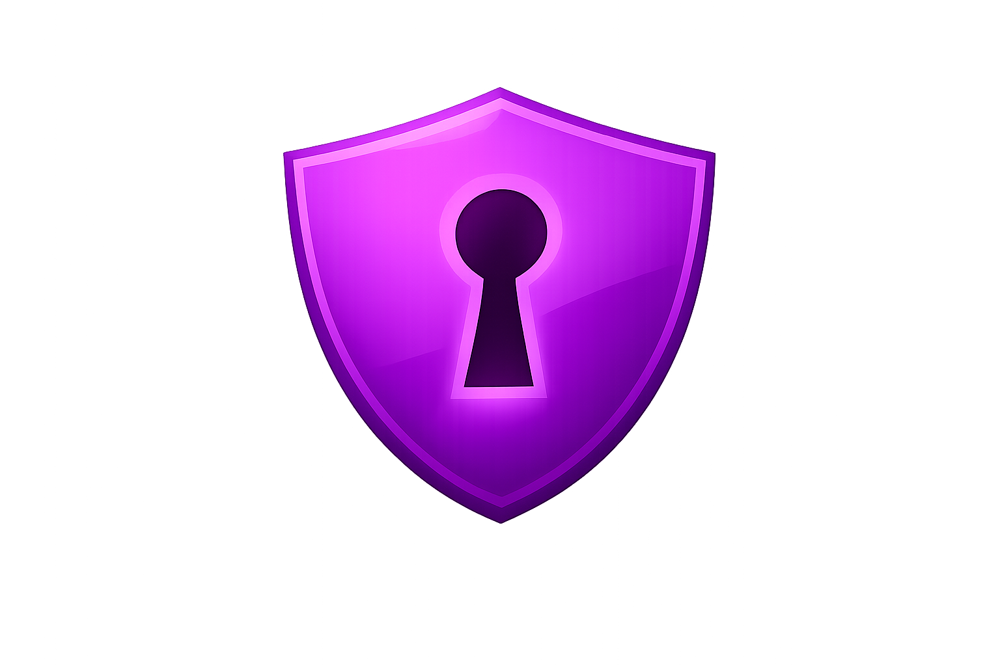

<p align="center">
  
</p>

# kdguard

[](https://www.rust-lang.org/)
[](https://github.com/KarnesTH/kdguard/releases/latest)
[](LICENSE)
[](https://github.com/KarnesTH/kdguard/releases)

Generate and check secure passwords in the terminal. Run `kdg` without options and it asks for everything, with your saved defaults preselected.

## Installation

Linux and macOS:

```bash
curl -LsSf https://raw.githubusercontent.com/KarnesTH/kdguard/main/install.sh | sh
```

Windows (PowerShell):

```powershell
powershell -ExecutionPolicy ByPass -c "irm https://raw.githubusercontent.com/KarnesTH/kdguard/main/install.ps1 | iex"
```

Both scripts verify the SHA-256 checksum of the release binary before installing it. `kdguard` is also available as `kdg`.

## Usage

```bash
kdg                                  # interactive
kdg -l 24 -c 3                       # 3 random passwords, 24 characters
kdg -p ULLLDDSS                      # pattern: U upper, L lower, D digit, S special
kdg -w 6                             # passphrase with 6 words
kdg --service github                 # deterministic, asks for the master seed
kdg --seed-env KDG_SEED --service github
kdg -c 5 -o passwords.txt            # save to a file (owner read/write only)
kdg | xclip -selection clipboard     # without a terminal only the passwords are printed

kdg check                            # hidden prompt
echo "$PASSWORD" | kdg check -       # from stdin
kdg check -d                         # with points per category

kdg config show
kdg config edit                      # interactive
kdg config edit -m phrase -p 20 -c 1 -a false -l de

kdg uninstall
```

| Mode            | Result                                                                  |
|-----------------|-------------------------------------------------------------------------|
| `random`        | 8 to 64 characters, always lowercase, uppercase, digit and special      |
| `pattern`       | one character per letter of the pattern                                 |
| `phrase`        | 3 to 20 words of a 7,776 word Diceware list (German or English)         |
| `deterministic` | 20 characters, always the same for the same seed, salt and service      |

Without `--mode` the mode follows from `--pattern`, `--words` or `--seed-env`/`--service`/`--salt`, otherwise from the config.

> **0.7.0:** deterministic passwords are now derived with PBKDF2-HMAC-SHA256 (600,000 iterations). They differ from the passwords of 0.6.x.

## Documentation

- [Commands and flow](docs/cli.md)
- [Security](docs/security.md)

## License

[MIT](LICENSE)