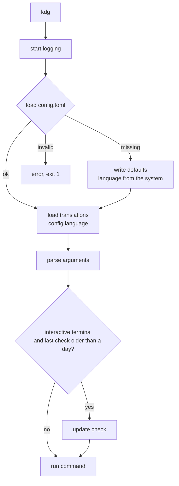
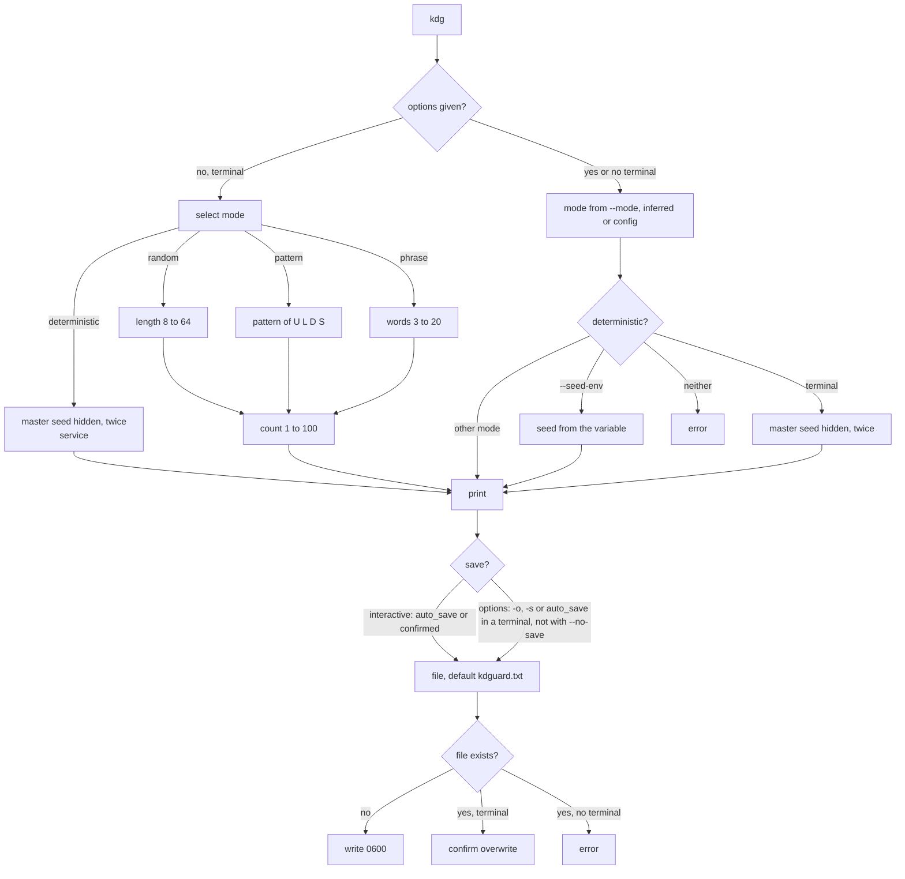
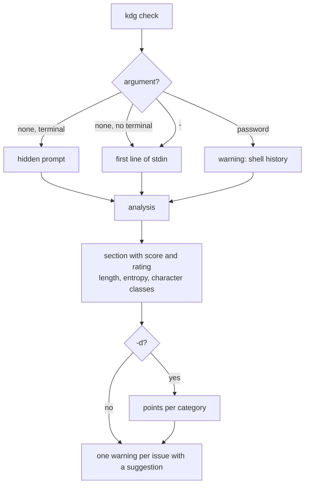

# Commands and flow

```
kdg                     interactive generation
kdg [OPTIONS]           generation with the given options, the rest from the config
kdg check [PASSWORD]    password check
kdg config show         print the config
kdg config edit         edit the config (interactive without options)
kdg uninstall           remove kdguard, config and logs
```

`-h`, `--help` and `kdg help` print the help of the named command with the kd-ui help layout in the config language; invalid arguments end with a short error and a hint to `kdg -h`.

Every command without options asks interactively when stdin and stdout are a terminal. Asked values have the config value preselected. Esc or Ctrl+C cancel a question and end the program with exit code 0. Errors are printed to stderr and end with exit code 1.

## Start



The update check is skipped for `uninstall`.

## Generation



| Option         | Default           | Values                                       |
|----------------|-------------------|----------------------------------------------|
| `-m, --mode`   | config            | `random`, `pattern`, `phrase`, `deterministic` |
| `-l, --length` | config            | 8 to 64                                      |
| `-c, --count`  | config            | 1 to 100 (deterministic: always 1)           |
| `-p, --pattern`|                   | `U`, `L`, `D`, `S`                           |
| `-w, --words`  | 6                 | 3 to 20                                      |
| `--seed-env`   |                   | name of an environment variable              |
| `--service`    |                   | any text                                     |
| `--salt`       |                   | any text                                     |
| `-s, --save`   | config `auto_save`| `auto_save` only applies in a terminal       |
| `--no-save`    |                   |                                              |
| `-o, --output` | `kdguard.txt`     | path, implies saving                         |

A weak master seed (rating weak or medium in the password check) is reported with a warning.

### Output

In a terminal: section line with mode and detail, the passwords in the value color, `n passwords generated`. Without a terminal (pipe, file) only the passwords, one per line, so `kdg | xclip` copies them directly. `auto_save` is ignored then; `-s` or `-o` still save.

## Check



| Category   | Points | Rule                                                              |
|------------|--------|-------------------------------------------------------------------|
| Length     | 0 to 25 | under 8: 0, 8 to 12: 10, 13 to 16: 20, more: 25                  |
| Diversity  | 0 to 30 | 5 per class (lower, upper, digit, special), 10 more for all four |
| Complexity | 0 to 25 | 15 without common password, 10 without triple repetition         |
| Entropy    | 0 to 20 | length × log2(pool): under 30 bit 5, under 40 bit 10, under 50 bit 15, more 20 |

A password from the list of the 10,000 most common passwords is capped at 20 points. Ratings: weak up to 40, medium up to 60, strong up to 80, very strong above.

## Config

`<config dir>/kdguard/config.toml`:

```toml
[general]
default_length = 16
default_count = 1
default_mode = "random"
auto_save = false

[language]
lang = "de"
```

`config edit` without options asks for mode, length, count, auto save and language. Values are checked on load and save; an invalid file stops the program with the path and the reason.

## Files

| Path                                   | Content                                   |
|----------------------------------------|-------------------------------------------|
| `<config dir>/kdguard/config.toml`     | config                                    |
| `<data dir>/kdguard/logs/`             | the 10 newest log files                   |
| `<data dir>/kdguard/update_check`      | time of the last update check             |

`<data dir>` is the state directory on Linux (`~/.local/state`) and the local data directory on macOS and Windows.

## Uninstall

After confirmation removes the config directory, the data directory, the `kdg` alias (only a symlink to the executable, on Windows `kdg.exe`) and the executable. Other files next to the executable stay. On Windows a detached `cmd` deletes the running executable and the open log file two seconds after the program ends and removes the install directory when it is empty.