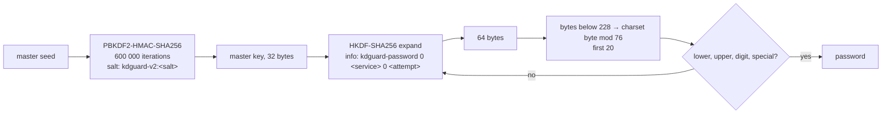

# Security

## Random numbers

All modes except `deterministic` draw from `ring::rand::SystemRandom` (the operating system CSPRNG). Indices are drawn by rejection sampling: a random `u32` at or above the largest multiple of the set size is drawn again, so every character and word is equally likely.

| Mode       | Entropy                                         |
|------------|-------------------------------------------------|
| random, 16 | 16 × log2(76) ≈ 100 bit                         |
| phrase, 6  | 6 × log2(7776) ≈ 77.5 bit                       |
| pattern    | sum of log2(26), log2(10) or log2(14) per letter |

## Deterministic passwords

- 600 000 iterations follow the OWASP recommendation for PBKDF2-HMAC-SHA256, so every guess of the master seed costs 600 000 HMAC rounds.
- Bytes from 228 on are skipped, 228 being the largest multiple of 76 below 256, so the mapping has no modulo bias.
- The seed is read hidden and twice (or from an environment variable with `--seed-env`), never from an argument.
- A weak seed is reported. All derived passwords are only as strong as the seed.

## Files

- Saved passwords are written with mode `0600` (Unix). An existing file is only replaced after confirmation.
- Logs contain no passwords, seeds, patterns, salts or service names, only modes, lengths and counts.

## Check

`kdg check` without argument reads the password hidden, `kdg check -` from stdin. A password given as argument works but prints a warning, because it ends up in the shell history and the process list.

## Update

- At most once a day and only in an interactive terminal.
- `curl` with `--proto =https --tlsv1.2`, the release tag must consist of letters, digits, `.` and `-`.
- The binary is downloaded next to the running executable as `<name>.new` and only installed when its SHA-256 matches `<asset>.sha256` of the release. A missing or wrong checksum cancels the update and removes the download.
- Failures are warnings, the program keeps working offline.

`install.sh` and `install.ps1` check the same `.sha256` file. The release workflow publishes one per binary.